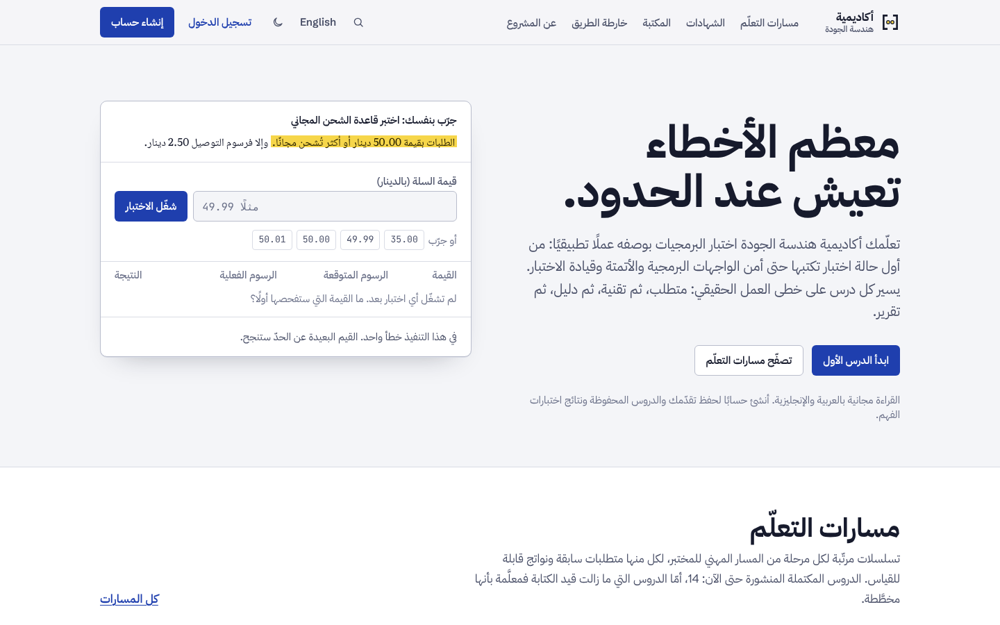
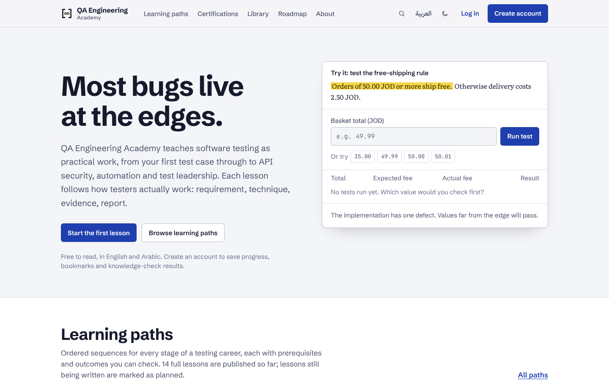
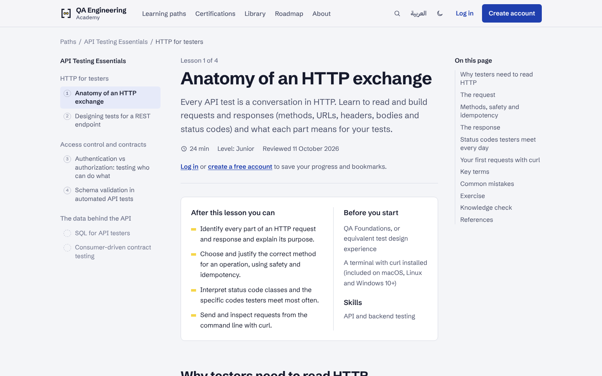

<div dir="rtl">

# أكاديمية هندسة الجودة

**منصة تعليمية ثنائية اللغة (العربية / English) لمختبري البرمجيات، من أول حالة اختبار إلى إدارة الاختبار.**

[English](README.md) · [التوثيق](#docs) · [التشغيل محليًا](#local) · [الحسابات التجريبية](#demo)

أنشأتها وتديرها **إيمان أبو عون**، أخصائية ضمان جودة · [LinkedIn](https://www.linkedin.com/in/eman-abo-oun-28ba40207/)

| العربية (من اليمين إلى اليسار) | English |
| --- | --- |
|  |  |
|  |  |

## ما هي المنصة؟

معظم دورات الاختبار مبنية حول الأدوات. أما أكاديمية هندسة الجودة فتعلّم الحكم المهني الذي تحتاجه قبل الأداة:

- اختيار القيم الحدّية الصحيحة؛
- مساءلة المتطلب الغامض قبل أن يصبح عيبًا؛
- التحقق ممن يحق له فعل ماذا، لا من أن الميزة تعمل فقط؛
- عرض المخاطر بطريقة يستطيع الفريق أن يتصرف بناءً عليها.

كل درس يتبع شكل العمل الحقيقي في ضمان الجودة (**متطلب ← تقنية ← دليل ← تقرير**)، مع أمثلة واقعية من البنوك والمدفوعات والتوصيل والتجارة الإلكترونية.

الموقع كله متاح بالإنجليزية على `/` وبالعربية على `/ar` باتجاه صحيح من اليمين إلى اليسار. يشمل ذلك كل درس واختبار فهم وصفحة شهادة واستوديو الإدارة.

## ما الموجود اليوم

كل ما يلي منفَّذ ومختبَر ويعمل. الميزات المخطط لها مذكورة وحدها، حتى لا يظهر شيء على أنه متاح وهو غير متاح.

**التعلّم**

- **8 مسارات تعلّم** تغطي كل مراحل المسار المهني:
  - أساسيات ضمان الجودة؛
  - الاختبار اليدوي التطبيقي؛
  - أساسيات اختبار الواجهات البرمجية (API)؛
  - أتمتة الويب باستخدام Playwright وTypeScript؛
  - هندسة الجودة للمستوى الخبير؛
  - قيادة الجودة؛
  - إدارة الاختبار؛
  - ضمان الجودة في المدفوعات والتقنية المالية (قيد الإعداد).
- **14 درسًا مكتملًا بالعربية والإنجليزية.**
  - لكل درس: أهداف، ومتطلبات سابقة، ومصطلحات أساسية، وأخطاء شائعة، وتمرين مع إجابة نموذجية، واختبار فهم يُصحَّح على الخادم، ومراجع، وتاريخ مراجعة.
  - و**25 درسًا آخر** منشورة كمخططات أولية موسومة بوضوح.
- **مركز الشهادات**: شهادات ISTQB® الحالية السبع والعشرين.
  - لا تظهر معلومات الامتحان إلا بعد التحقق منها على الصفحة الرسمية، مع المصدر وتاريخ المراجعة.
  - الموثّق منها 4: ‏CTFL v4.0 وCTAL-TA وCTAL-TAE v2.0 وCTAL-TM v3.0.
  - لشهادة CTFL خطة دراسة لأربعة أسابيع و10 أسئلة تدريب أصلية باللغتين.
- **المكتبة**:
  - 7 نماذج قابلة للتنزيل باللغتين: خطة اختبار، جدول حالات اختبار، تقرير خطأ، مصفوفة تتبّع، سجل مخاطر، ميثاق جلسة استكشافية، قائمة جاهزية الإصدار؛
  - 5 مشاريع تدريبية لملف الأعمال؛
  - 8 مقاطع يوتيوب مختارة من القنوات الرسمية للأدوات، بروابط ونسبة واضحة لصاحبها، ولا تُحمَّل إلا عند الضغط على تشغيل.
- **البحث** في الدروس والمسارات والشهادات باللغتين. البحث العربي يتعامل مع «ال» التعريف وصيغ الهمزة والتشكيل.

**الحسابات**

- إنشاء حساب (كل حساب جديد **متعلّم**)، وتسجيل الدخول والخروج، وجلسات متعددة.
- استعادة كلمة المرور بروابط تُستخدم مرة واحدة وتنتهي صلاحيتها.
- الملف الشخصي واللغة المفضّلة، وتغيير كلمة المرور (يسجّل الخروج من الأجهزة الأخرى)، وحذف الحساب.
- **لوحتي**: تابع من حيث توقفت، والتقدّم في كل مسار، وخريطة المهارات، وسجلّ اختبارات الفهم، والدروس المحفوظة.

**استوديو الإدارة** (للمدرّبين والمسؤولين)

- محرّر ثنائي اللغة للمسارات والوحدات والدروس، مع سير عمل تحريري: مسودة ← قيد المراجعة ← منشور ← مؤرشف.
  - النشر يتطلب محتوى إنجليزيًا **وعربيًا** مكتملًا.
  - ويتطلب مفاتيح إجابات متطابقة في اختبار الفهم باللغتين.
- سجلات الشهادات، وتوثيق المعلومات للمسؤولين فقط.
- إضافة مقاطع الفيديو برابط يوتيوب.
- إدارة المستخدمين والصلاحيات (للمسؤولين فقط، مع حماية آخر مسؤول).
- سجلّ تدقيق لكل تغيير.

**الجودة**

- 82 اختبار وحدة (Vitest) و50 اختبارًا شاملًا (Playwright) على نسخة الإنتاج، باللغتين، على سطح المكتب وعلى شاشة Pixel 7.
- فحص الأنواع والـ lint نظيفان، و`npm audit --omit=dev` لا يجد أي ثغرة.
- تعمل الفحوصات كلها تلقائيًا على GitHub Actions مع كل رفع.
- سهولة وصول مدروسة:
  - رابط «انتقل إلى المحتوى»، ومعالم صفحة واضحة؛
  - نماذج بعناوين ورسائل خطأ مرتبطة بحقولها؛
  - قوائم تعمل بلوحة المفاتيح، وتركيز مرئي؛
  - وضع فاتح وداكن، ولا تمرير أفقي على الهاتف.

**لم يُبنَ بعد (مخطط له):** إرسال بريد إلكتروني حقيقي (روابط إعادة التعيين تذهب حاليًا إلى سجلّ الخادم وصندوق رسائل التطوير)، واختبارات تجريبية مؤقتة، ورفع المستخدمين لمقاطع فيديو مع إشراف، وأسئلة وأجوبة مجتمعية، والتحضير للمقابلات، ومختبرات تفاعلية. انظر [القيود المعروفة](docs/KNOWN_LIMITATIONS.md) وصفحة خارطة الطريق في الموقع.

<a id="local"></a>

## التشغيل محليًا

تحتاج **Node.js 22 أو أحدث** ([nodejs.org](https://nodejs.org/)، نسخة LTS)، ولا شيء غيره: قاعدة البيانات ملف، ولا حاجة لأدوات بناء C++ على ويندوز أو ماك أو لينكس.

<div dir="ltr">

```bash
git clone https://github.com/eman-dev2/qa-engineering-academy.git
cd qa-engineering-academy
npm ci
npm run dev
```

</div>

افتح <http://localhost:3000/ar> (العربية) أو <http://localhost:3000> (الإنجليزية).

أول تشغيل لـ `npm run dev`:

- ينشئ `data/academy.db`؛
- يحمّل كل المحتوى؛
- ينشئ [الحسابات التجريبية](#demo).

لا يحذف أي شيء أبدًا: التشغيلات اللاحقة تضيف المحتوى الناقص فقط.

<details>
<summary><b>على ويندوز خطوة بخطوة (PowerShell)</b></summary>

1. ثبّت Node.js 22 LTS من <https://nodejs.org/> (اترك الخيارات الافتراضية). افتح نافذة PowerShell **جديدة** وتحقق: الأمر `node --version` يجب أن يطبع `v22…` أو أعلى.
2. ثبّت Git من <https://git-scm.com/download/win>، أو نزّل المستودع ملفًا مضغوطًا من GitHub (**Code ← Download ZIP**) وفُكّ ضغطه.
3. في PowerShell:

<div dir="ltr">

```powershell
cd C:\path\to\qa-engineering-academy
npm ci
npm run dev
```

</div>

4. افتح <http://localhost:3000/ar>. لإيقاف الخادم اضغط **Ctrl + C**.

إذا ظهرت رسالة أن تشغيل السكربتات معطّل لـ `npm`، نفّذ مرة واحدة `Set-ExecutionPolicy -Scope CurrentUser RemoteSigned`، أو استخدم Command Prompt بدلًا من PowerShell.

</details>

### أوامر مفيدة

| الأمر | ماذا يفعل |
| --- | --- |
| `npm run dev` | خادم التطوير مع الحسابات التجريبية |
| `npm run build` ثم `npm start` | بناء نسخة الإنتاج وتشغيلها (المنفذ 3000) |
| `npm run check` | فحص الأنواع والـ lint واختبارات الوحدة |
| `npm run test:e2e` | الاختبارات الشاملة (في أول مرة نفّذ `npx playwright install chromium`) |
| `npm run db:seed` | إضافة المحتوى الناقص والحسابات التجريبية (آمن للتكرار) |
| `npm run db:seed -- --reset-demo` | إعادة إنشاء الحسابات التجريبية وتقدّمها النموذجي |
| `npm run db:reset -- --yes` | حذف قاعدة البيانات المحلية وإعادة بنائها (للتطوير فقط) |
| `npm run admin:create -- --email you@example.com --name "Your Name"` | إنشاء أول مسؤول (تُطلب كلمة المرور بإدخال مخفي) |
| `npm run user:role -- grant someone@example.com instructor` | منح صلاحية أو سحبها من سطر الأوامر |

### الإعدادات

لا تحتاج أي حسابات خارجية أو مفاتيح API أو مزوّد مصادقة: المصادقة مبنية داخل المشروع، وقاعدة البيانات ملف محلي. في التطوير كل الإعدادات اختيارية. لتغيير أي منها انسخ `.env.example` إلى `.env.local`.

| المتغير | الاستخدام |
| --- | --- |
| `DATABASE_PATH` | مكان ملف SQLite (الافتراضي `./data/academy.db`) |
| `NEXT_PUBLIC_SITE_URL` | العنوان العام لروابط إعادة التعيين وخريطة الموقع (في الإنتاج) |
| `ADMIN_EMAIL` و`ADMIN_PASSWORD` و`ADMIN_NAME` | أول مسؤول، يُنشأ عند التشغيل إذا لم يوجد مسؤول (على الخادم فقط) |
| `DEMO_PASSWORD` | كلمة مرور الحسابات التجريبية في التطوير |

كل المتغيرات مشروحة في [دليل النشر](docs/ar/DEPLOYMENT.md).

### قاعدة البيانات والترحيلات وبيانات البداية

- ملفات الترحيل في `drizzle/`، وتُطبَّق تلقائيًا مع `npm run dev` و`npm run build` و`npm start`. بعد تعديل `src/lib/db/schema.ts` نفّذ `npm run db:generate` وأضف ملف SQL الجديد إلى المستودع.
- تحميل البيانات **يضيف الناقص فقط**: 8 مسارات، و18 وحدة، و39 درسًا (14 منها مكتملة باللغتين)، و27 شهادة، و8 مقاطع فيديو، و7 نماذج، و5 مشاريع تدريبية.
- لا يحذف ولا يستبدل شيئًا إلا إذا مرّرت `--force-content` صراحة.
- التفاصيل وكل الأوامر في [DATABASE.md](docs/DATABASE.md#5-seeding-rules).

### النشر

[](https://render.com/deploy?repo=https://github.com/eman-dev2/qa-engineering-academy)

الزر يفتح Render بإعدادات هذا المستودع (`render.yaml`)، على **الخطة المجانية** المناسبة للتجربة:

- الخدمة تنام عند عدم وجود زوار؛
- الحسابات المنشأة عليها تضيع عند كل إعادة تشغيل، لأنه لا يوجد قرص دائم؛
- المحتوى والمسؤول يُعاد إنشاؤهما تلقائيًا.

سيطلب Render قيمتين فقط: `ADMIN_EMAIL` و`ADMIN_PASSWORD`.

المستودع يحتوي أيضًا على `Dockerfile` وعلى سير عمل GitHub Actions يشغّل كل الاختبارات مع كل رفع. الخطوات التفصيلية في [دليل النشر بالعربية](docs/ar/DEPLOYMENT.md). تشمل الخطة المجانية، والإعداد الدائم المدفوع، وDocker، وخادم لينكس عادي.

<a id="demo"></a>

## الحسابات التجريبية

تُنشأ تلقائيًا في بيئة التطوير فقط، وتُرفض عندما يكون `NODE_ENV=production`. كلمة المرور لها جميعًا: **`Demo-Password-2026`**.

| البريد | الصلاحيات | ملاحظات |
| --- | --- | --- |
| `mutaallim@demo.qa-academy.test` | متعلّم | بالعربية، مع تقدّم نموذجي |
| `learner@demo.qa-academy.test` | متعلّم | بالإنجليزية، مع تقدّم نموذجي |
| `instructor@demo.qa-academy.test` | متعلّم، مدرّب | يكتب مسودات الدروس ويرسلها للمراجعة |
| `admin@demo.qa-academy.test` | متعلّم، مسؤول | استوديو الإدارة كاملًا |

على الموقع العام أنشئ المسؤول الحقيقي عبر `ADMIN_EMAIL` و`ADMIN_PASSWORD` أو عبر `npm run admin:create`. انظر [دليل الإدارة](docs/ar/ADMIN_GUIDE.md).

<a id="docs"></a>

## التوثيق

| المستند | المحتوى |
| --- | --- |
| [دليل المستخدم](docs/ar/USER_GUIDE.md) · [User guide](docs/USER_GUIDE.md) | استخدام الموقع كمتعلّم |
| [دليل الإدارة](docs/ar/ADMIN_GUIDE.md) · [Admin guide](docs/ADMIN_GUIDE.md) | استوديو الإدارة، الصلاحيات، أول مسؤول |
| [النشر والتشغيل](docs/ar/DEPLOYMENT.md) · [Deployment](docs/DEPLOYMENT.md) | التشغيل المحلي، Render، Docker، متغيرات البيئة |
| [Project overview](docs/PROJECT_OVERVIEW.md) | الهدف، الجمهور، النطاق، ما أُنجز وما التالي |
| [Architecture](docs/ARCHITECTURE.md) | التقنيات، الهيكل، العرض والتخزين المؤقت، تعدد اللغات، القرارات |
| [Information architecture](docs/INFORMATION_ARCHITECTURE.md) | الصفحات، التنقل، الروابط، نموذج المحتوى، رحلات المستخدم |
| [Database](docs/DATABASE.md) | الجداول، القيود والفهارس، الترحيلات، بيانات البداية، النسخ الاحتياطي |
| [Security and permissions](docs/SECURITY_AND_PERMISSIONS.md) | المصادقة، الجلسات، الصلاحيات، المخاطر والضوابط |
| [Testing](docs/TESTING.md) | استراتيجية الاختبار، الحزم، طريقة التشغيل، التغطية |
| [Known limitations](docs/KNOWN_LIMITATIONS.md) | ما لم يُنجز ولماذا |
| [Diagrams](docs/diagrams/README.md) | 14 مخططًا بـ Mermaid، مع تمييز المنفَّذ من المخطط له |
| [Implementation report](docs/IMPLEMENTATION_REPORT.md) | ما بُني، نتائج التحقق، الخطوات التالية |

المستندات التقنية (المعمارية، قاعدة البيانات، الأمان، الاختبارات) مكتوبة بالإنجليزية لأنها موجّهة للمطوّرين. أما الأدلة التي يحتاجها المستخدمون والمسؤولون فمتاحة باللغتين.

## التقنيات

Next.js 16 (App Router وCache Components وServer Actions) · React 19 · TypeScript · Tailwind CSS 4 · SQLite مع better-sqlite3 وDrizzle ORM · Zod · unified/remark/Shiki لعرض الدروس · Vitest · Playwright.

## المحتوى والعلامات التجارية

- الدروس والتمارين وأسئلة التدريب عمل أصلي كُتب لهذا الموقع.
- ISTQB® علامة تجارية مسجّلة لـ International Software Testing Qualifications Board. هذا المشروع مستقل وغير تابع لـ ISTQB ولا لأي جهة شهادات.
- مقاطع الفيديو ملك أصحابها، وتُعرض بالرابط والتضمين فقط، ولا يُعاد رفعها أبدًا.

© 2026 إيمان أبو عون. جميع الحقوق محفوظة.

</div>
