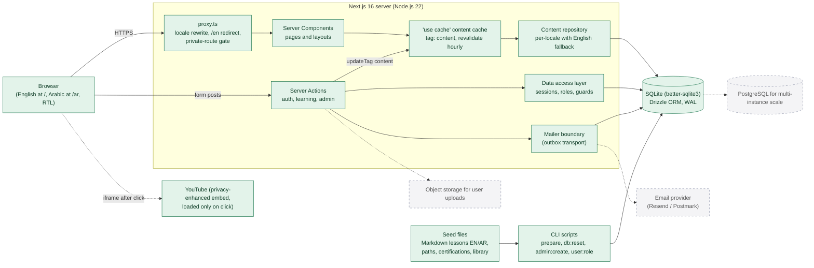

# 1. System architecture

**Legend:** solid green boxes are implemented in this repository; dashed grey boxes are planned and **not** implemented.

## Notes

- **Implemented:** everything in the server box, SQLite, seed files and CLI scripts. Code: `src/proxy.ts`, `src/app`, `src/app/actions`, `src/lib/auth`, `src/lib/content/repo.ts`, `src/lib/mailer.ts`, `scripts/`, `seed/`.
- **Planned:** a real email provider (password-reset emails are stored in the outbox table and written to the server log today), object storage for user uploads, and PostgreSQL if the site ever needs more than one server instance.
- Content is read through cached functions tagged `content`. Admin changes call `updateTag("content")`, so edits show immediately. The hourly revalidation covers deployments where the build reads a different database file from the running server.
