# 2. Sitemap

**Legend:** green = implemented, dashed grey = planned. Every public page exists in English (`/…`) and Arabic (`/ar/…`). Private pages are marked with a lock.

```mermaid
flowchart TB
  classDef done fill:#e3f3ea,stroke:#17734a,color:#0f3d27
  classDef private fill:#e6eaf9,stroke:#1f3fae,color:#162f87
  classDef planned fill:#f4f4f6,stroke:#8a90a6,stroke-dasharray:5 5,color:#555

  Home["/ Home"]:::done
  Home --> Paths["/paths<br/>catalog + level filter"]:::done
  Paths --> Path["/paths/:path<br/>modules, planned outlines"]:::done
  Path --> Lesson["/paths/:path/:lesson<br/>lesson, exercise, knowledge check"]:::done
  Home --> Certs["/certifications<br/>ISTQB portfolio + filters"]:::done
  Certs --> Cert["/certifications/:slug<br/>verified facts, study plan, practice"]:::done
  Home --> Library["/library<br/>templates, projects, videos"]:::done
  Library --> Project["/library/projects/:slug"]:::done
  Home --> Search["/search?q="]:::done
  Home --> Roadmap["/roadmap"]:::done
  Home --> About["/about<br/>owner + LinkedIn"]:::done

  Home --> Login["/login"]:::done
  Home --> Signup["/signup"]:::done
  Login --> Forgot["/forgot-password"]:::done
  Forgot --> Reset["/reset-password?token="]:::done

  Home --> Dashboard["🔒 /dashboard"]:::private
  Home --> Account["🔒 /account<br/>profile, password, sessions, delete"]:::private
  Home --> Admin["🔒 /admin (instructor, admin)"]:::private
  Admin --> AContent["🔒 /admin/content<br/>paths, modules, lessons"]:::private
  Admin --> ACerts["🔒 /admin/certifications"]:::private
  Admin --> AVideos["🔒 /admin/videos"]:::private
  Admin --> AUsers["🔒 /admin/users (admin only)"]:::private
  Admin --> AAudit["🔒 /admin/audit"]:::private
  Dev["/dev/outbox (development only)"]:::done

  Home -.-> Mock["/certifications/:slug/mock-exam"]:::planned
  Home -.-> Community["/community, Q&A, showcases"]:::planned
  Home -.-> Interview["/interview-prep"]:::planned
  Home -.-> Labs["/labs (simulated APIs, SQL)"]:::planned
```

## Notes

- `robots.txt` disallows private and authentication pages; `sitemap.xml` lists public pages in both languages with `hreflang` alternates (`src/app/robots.ts`, `src/app/sitemap.ts`).
- Unprefixed URLs serve English; `/en/...` redirects (308) to the unprefixed URL so every page has one address; `/ar/...` serves Arabic with `dir="rtl"` (`src/proxy.ts`).
- `/dev/outbox` exists only in development builds; production builds return 404.
