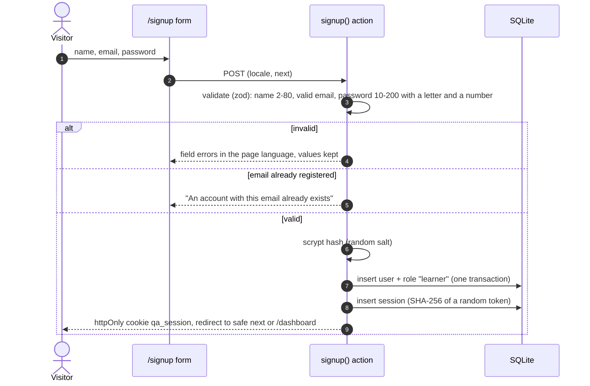
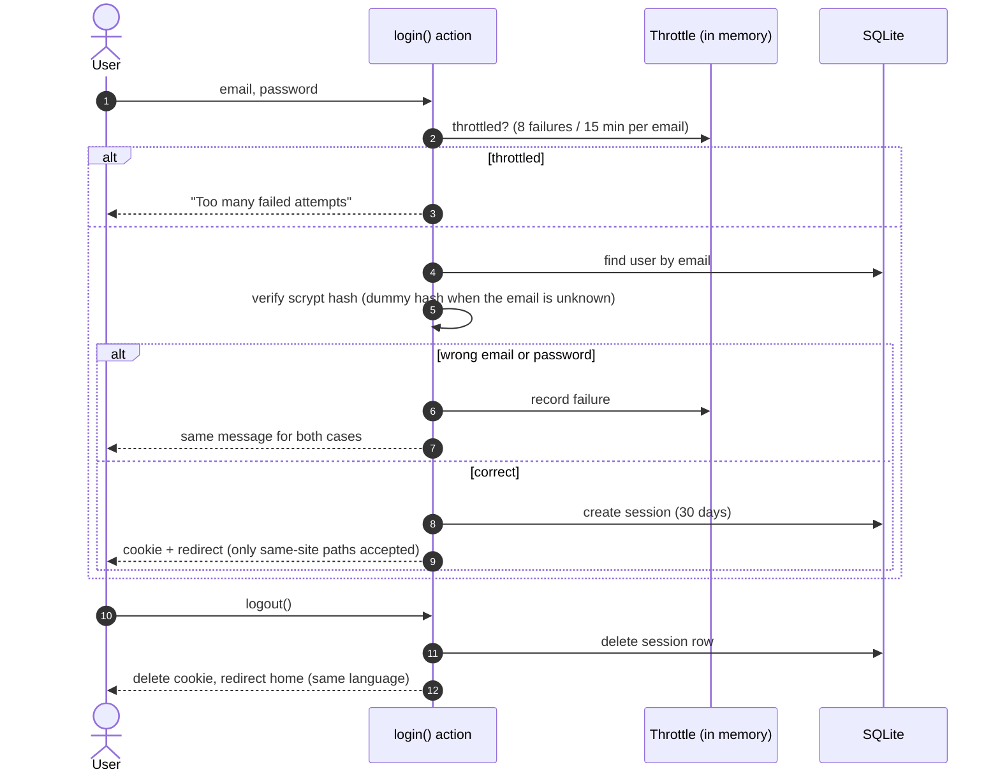
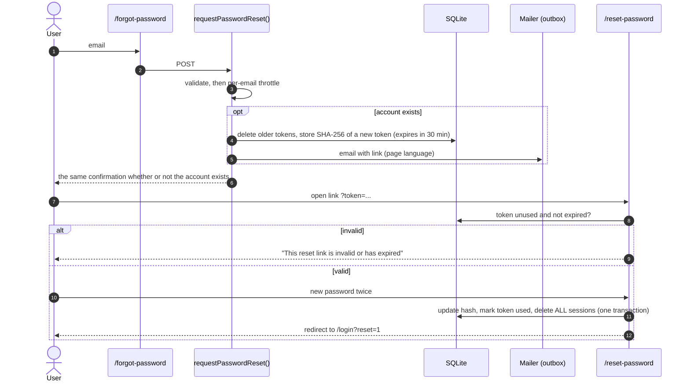

# 3. Registration, login, logout and password recovery

All four flows are **implemented**. Planned additions are listed at the end.

## Registration

## Login and logout

## Password recovery

## Implemented versus planned

| Item | Status |
| --- | --- |
| Registration, validation, learner role by default | Implemented (`src/app/actions/auth.ts`) |
| Login, logout, safe redirects, throttle, generic errors | Implemented |
| Multiple accounts and multiple sessions per account | Implemented (account page lists the session count and can log out other devices) |
| Password reset with single-use, expiring, hashed tokens | Implemented |
| Sending real email | **Planned.** Messages go to the `email_outbox` table and the server log; `/dev/outbox` shows them in development only |
| Email verification, two-factor authentication, social login | **Planned** |
| Shared (database or Redis) login throttle | **Planned.** The current throttle is per process and resets on restart |
