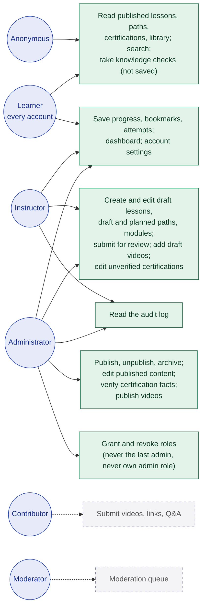

# 4. Roles and permissions

**Legend:** green = enforced in code today; dashed grey = role exists in the schema but its features are planned.

## Enforcement points

| Layer | What it checks | Code |
| --- | --- | --- |
| Proxy | No session cookie on `/dashboard`, `/account`, `/admin` → redirect to login (optimistic only) | `src/proxy.ts` |
| Pages | Session lookup + expiry; staff role for `/admin/*`; administrator for `/admin/users` | `src/lib/auth/dal.ts`, `src/lib/admin/guard.ts` |
| Server actions | Every admin action re-checks the role and the content status before writing | `src/app/actions/admin.ts` |
| Workflow | Which status changes each role may make | `src/lib/admin/workflow.ts` |
| CLI | First administrator and role changes from the server's command line | `scripts/create-admin.ts`, `scripts/set-role.ts` |

New registrations always receive only the `learner` role. The `admin` role passes every role check. No admin credential or bootstrap secret is ever sent to the browser.
