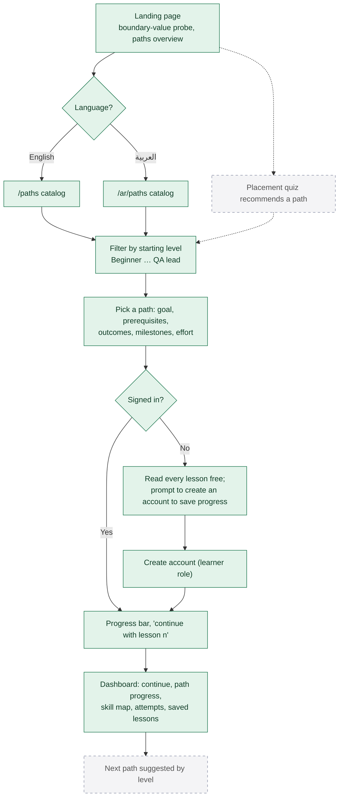

# 5. Onboarding and learning paths

**Legend:** green = implemented, dashed grey = planned.

## The paths in the seed data

| Path | Levels | Published lessons | Planned lessons |
| --- | --- | --- | --- |
| QA Foundations | Beginner → Junior | 5 | 0 |
| Practical Manual Testing | Junior → Mid-level | 1 | 5 |
| Web Automation with Playwright and TypeScript | Junior → Automation engineer | 1 | 4 |
| API Testing Essentials | Mid-level → Senior | 4 | 2 |
| Senior Quality Engineering | Senior → Head of QE | 1 | 3 |
| QA Leadership | Senior → QA lead | 1 | 3 |
| Test Management | QA lead → Test manager | 1 | 3 |
| Payments and Fintech QA (in development) | Mid-level → Senior | 0 | 5 |

Planned lessons appear as outlines (title, summary, objectives) marked **Planned**; they have no body and cannot be opened. Exact level ranges are in `seed/content/paths.ts`.
