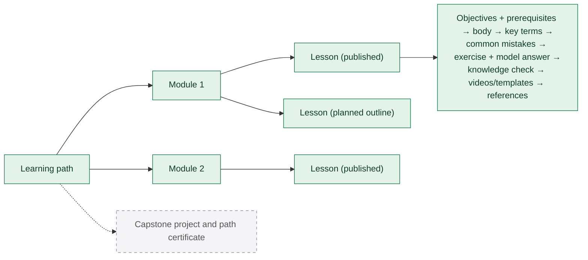
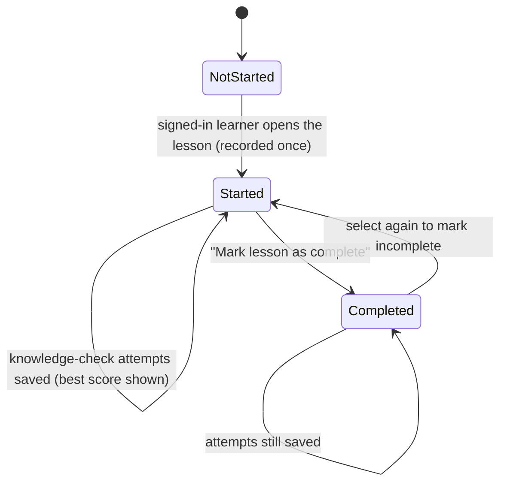

# 6. Path, module and lesson progression

All states below are **implemented** unless marked planned.

## Content structure

## A learner's progress on one lesson

## Rules

- Progress is stored per lesson key `"<path-slug>/<lesson-slug>"` (`lesson_progress`), so editing a lesson's text never loses progress. The slug is locked once a lesson has been published.
- Completing a lesson does not require passing its knowledge check; the dashboard shows both.
- The dashboard "continue" card picks the most recently opened unfinished lesson, otherwise the first unfinished lesson overall.
- The skill map counts completed lessons per skill, out of the lessons published for that skill.
- Only published lessons accept progress, bookmarks and attempts (`isPublishedLessonKey`).
