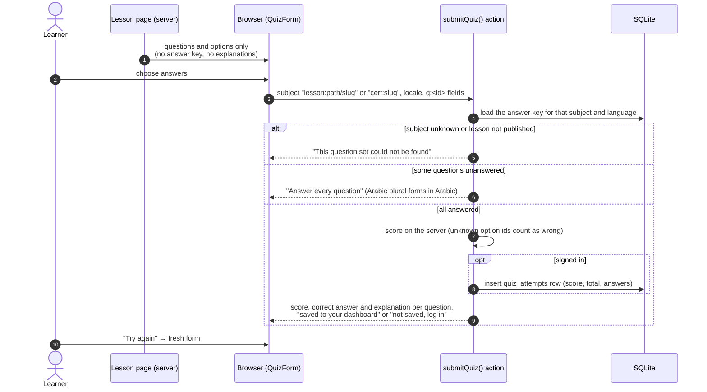

# 7. Knowledge-check (quiz) flow

**Implemented** for lesson knowledge checks and the CTFL practice set.

## Rules

- Arabic and English versions of a knowledge check must have the same question ids, option ids and answers (`quizKeysMatch`). The seed loader, the admin editor and the unit tests all enforce this, so an attempt means the same thing in both languages.
- Anonymous attempts are scored but never stored.
- **Planned:** timed mock exams with a question pool, randomisation and per-chapter score breakdowns (see diagram 8).
