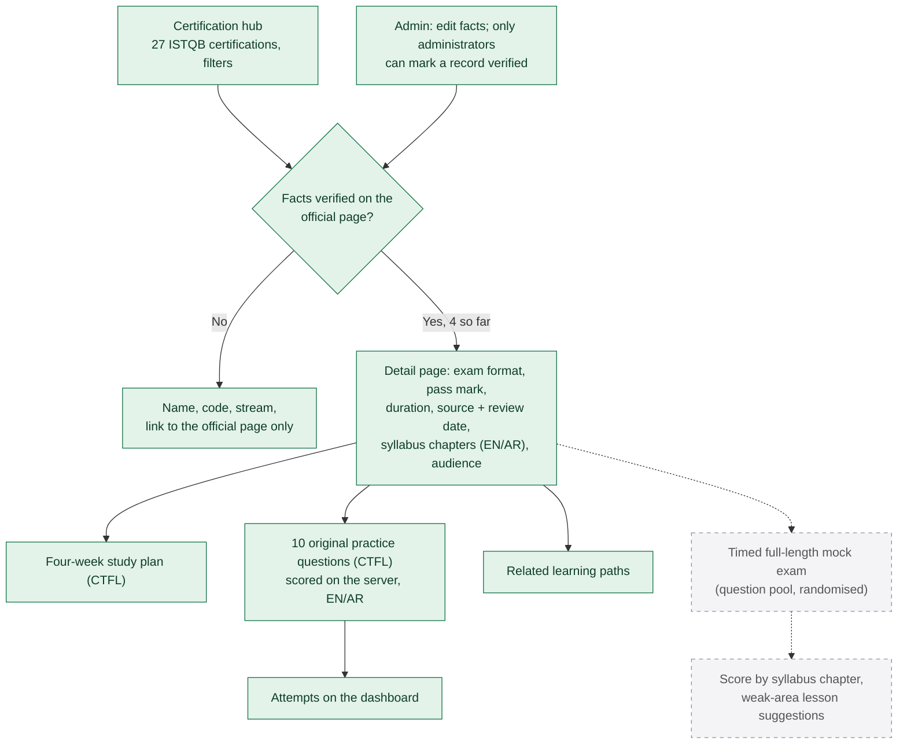

# 8. Certification preparation and mock exams

**Legend:** green = implemented, dashed grey = planned.

## Rules

- Exam facts (questions, points, pass mark, duration, non-native extension) are shown **only** for records marked verified, each with its source URL and review date. Unverified records store no facts at all (unit-tested).
- Fees are never listed: they vary by exam provider and country.
- Practice questions are written for this site. Official sample exams are linked, never copied. No leaked or "real" exam questions are used.
- Verified so far (reviewed 2026-10-11/12): CTFL v4.0, CTAL-TA, CTAL-TAE v2.0, CTAL-TM v3.0. Details in `seed/content/certifications.ts`.
