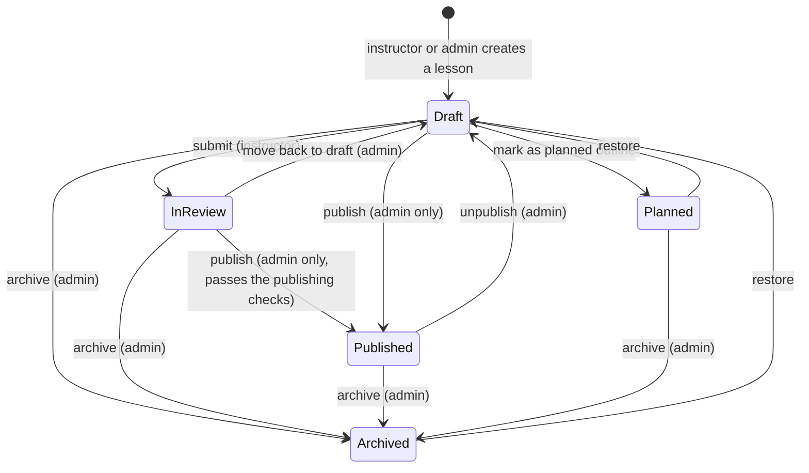

# 9. Admin content workflow

**Implemented** for lessons (`src/lib/admin/workflow.ts`, `src/app/actions/admin.ts`). Paths use the same statuses through a select box; videos use draft / published / archived.

## Publishing checks (both languages)

A lesson can only be published, or edited while published, when **all** of these hold (`publishProblems`):

1. English **and** Arabic text exist.
2. Each body has at least 300 words.
3. At least two objectives and two common mistakes; a complete exercise with a model answer.
4. A knowledge check with at least three valid questions in each language, with matching ids and answers.
5. At least one https reference.
6. A review date and at least one skill.

## Other rules

- The URL slug is locked after first publication, because learner progress is keyed by it.
- Instructors cannot edit published content; administrators can, and the checks above still apply.
- Every create, update and status change writes an `audit_log` row (who, what, when, before → after).
- Saving calls `updateTag("content")`, so public pages show the change immediately.
- **Planned:** side-by-side diff and revision history, scheduled publishing, reviewer comments.
