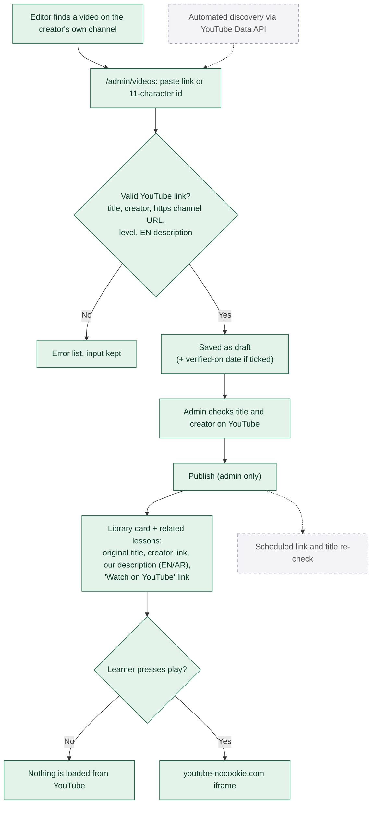

# 10. YouTube video discovery, attribution and embedding

**Legend:** green = implemented, dashed grey = planned.

## Rules

- Videos are only linked and embedded. They are never downloaded or re-hosted, and there is no upload field (e2e-tested).
- The original title is kept as published by the creator; our own description explains why it's useful, in both languages.
- The 8 seeded videos (7 from the official Playwright channel, 1 from Visual Studio Code) were checked on 2026-10-12.
