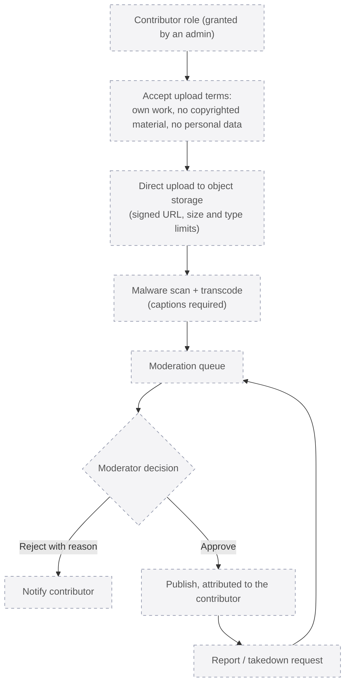

# 11. User video uploads

**Status: planned. Nothing in this diagram is implemented.** The site has no upload field, no storage bucket and no processing pipeline. This diagram is the agreed design for a later phase (roadmap phase 3), so that the database and permissions can be extended without surprises.

## Why it is planned, not built

- Hosting user video needs storage, transcoding, captioning, malware scanning, a moderation team and a copyright takedown process. None of these exist yet, and faking any of them would be dishonest and unsafe.
- The `contributor` and `moderator` roles already exist in the schema so that the permission model doesn't need a migration later. They currently grant nothing beyond the learner role.
