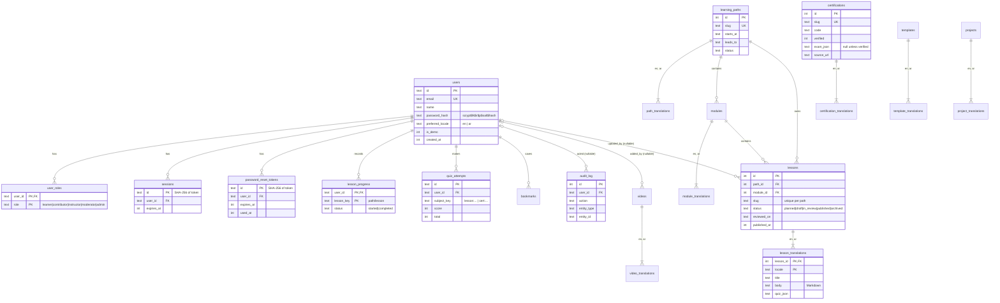

# 12. Entity-relationship diagram

All tables below are **implemented** (`src/lib/db/schema.ts`, migration `drizzle/0000_init.sql`). Planned tables are listed after the diagram.

Also implemented: `email_outbox` (development mailer), `bookmarks`, and the translation tables' JSON columns for objectives, key terms, mistakes, exercise, references, study plans and practice questions. Full column list: [DATABASE.md](../DATABASE.md).

**Planned tables:** `video_submissions` and `moderation_actions` (diagram 11), `mock_exams` / `mock_exam_attempts` (diagram 8), `lesson_revisions` (diagram 9), `email_verifications`.
