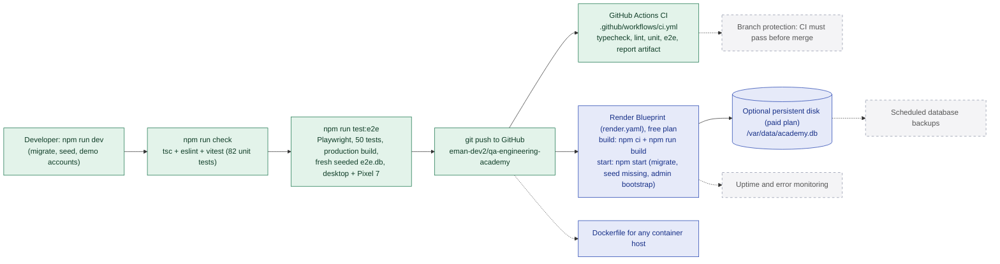

# 13. Testing, CI/CD and deployment

**Legend:** green = implemented and running, blue = configured in the repository and ready to connect, dashed grey = planned.

## Notes

- Unit and end-to-end suites pass locally and in GitHub Actions on every push to `main` (see [TESTING.md](../TESTING.md)).
- The Render Blueprint is committed and ready; it runs once the repository is connected to a Render account ([DEPLOYMENT.md](../DEPLOYMENT.md#5-render)). The production build and start sequence it uses was reproduced locally from a clean clone.
- The Dockerfile follows the same steps but was not built here (no Docker daemon in this environment).
