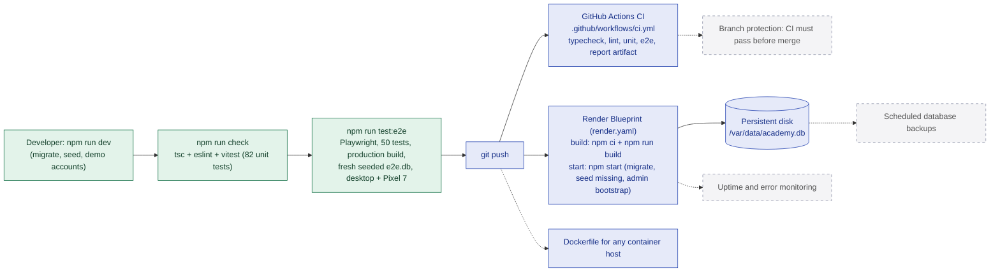

# 13. Testing, CI/CD and deployment

**Legend:** green = implemented and run, blue = configured in the repository (runs once the repository is on GitHub / Render), dashed grey = planned.

## Notes

- Unit and end-to-end suites were run in this environment and pass (see [TESTING.md](../TESTING.md)).
- The CI workflow and Render Blueprint are committed and ready, but they only run once the repository is pushed to GitHub and connected to Render. The production build and start sequence they use was reproduced locally from a clean clone.
- The Dockerfile follows the same steps but was not built here (no Docker daemon in this environment).
