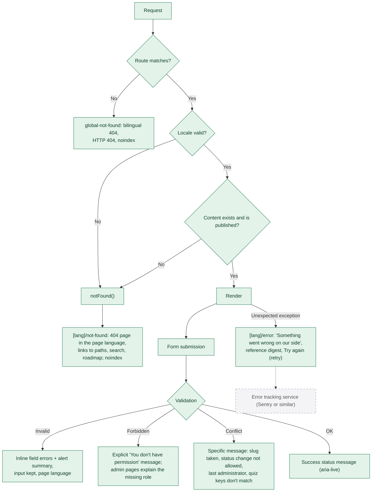

# 14. Error handling

All paths below are **implemented** unless marked planned.

## Rules

- Users never see stack traces. The error boundary shows a short message and a reference (`digest`) that matches the server log.
- Validation errors are written for the person reading them, in their language, and say how to fix the problem.
- Failed admin saves keep everything the editor typed (the form doesn't reset).
- Authentication errors never reveal whether an email has an account.
- Unknown slugs under streamed routes return the not-found page with `noindex` but HTTP 200 (a documented Next.js behaviour once streaming has started); unmatched URLs return a real 404. See [KNOWN_LIMITATIONS.md](../KNOWN_LIMITATIONS.md).
